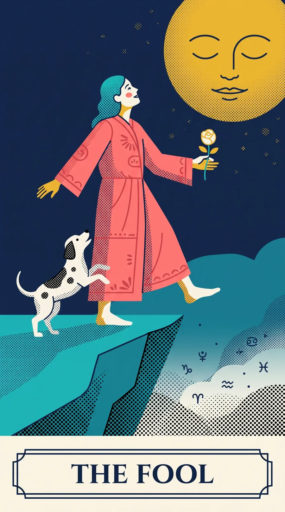

# Halftone Arcana

The 22 Major Arcana as original illustrations, a written card-meaning dataset, and the
3D card-flip component they were built for.

Pulled out of [drawatarotcard.com](https://www.drawatarotcard.com), a free random tarot
card draw — no signup, no email, nothing stored server-side.



## What's here

| Path | What it is |
|---|---|
| `data/major-arcana.json` | All 22 cards: keywords, upright, reversed, love, career, yes/no, advice, artwork description. ~11,500 words. |
| `cards/*.webp` | The 22 card faces plus the card back, 900×1613 WebP. |
| `src/TarotCard.tsx` | React component: 3D flip, shuffle animation, fallback image, keyboard/AX labels. |
| `src/card-flip.css` | The flip and shuffle CSS on its own — no framework needed. |
| `src/random.ts` | Uniform pick, deal-without-replacement, and a date-seeded "card of the day". |

## The dataset

```json
{
  "number": 16,
  "name": "The Tower",
  "slug": "the-tower",
  "keywords": { "upright": ["sudden change", "upheaval", …], "reversed": [...] },
  "upright": ["The Tower shows a tall structure struck by lightning…"],
  "reversed": [...],
  "yesNo": { "answer": "No", "why": "The Tower is a no, particularly for plans that…" },
  "love": [...], "career": [...],
  "advice": "When things fall apart, let them…",
  "artworkDescription": "A grey stone tower burns against a navy night sky…"
}
```

Every card carries an `artworkDescription` written against *this* deck, including where it
departs from classic Rider-Waite-Smith imagery (The Fool is a woman here; the Sun's rider
is clothed; Death's horse is black).

## Card of the day

`src/random.ts` includes a deterministic daily card — same date, same card, for everyone,
with no storage:

```ts
import { cardForDate, todayUTC } from './random';
const card = cards[cardForDate(todayUTC(), cards.length)];
```

FNV-1a over the date string, so it's stable across rebuilds and runtimes.

## Licences

| What | Licence |
|---|---|
| Code (`src/`) | [MIT](LICENSE) |
| Card meanings (`data/`) | [CC BY 4.0](https://creativecommons.org/licenses/by/4.0/) |
| Illustrations (`cards/`) | [CC BY 4.0](https://creativecommons.org/licenses/by/4.0/) — see the note below |

### An honest note on the illustrations

**The card illustrations were generated with AI** (Midjourney), then selected, edited and
assembled by hand. In the United States, material generated by AI without sufficient human
authorship has been held not to attract copyright — the Copyright Office reached that
conclusion about Midjourney images in the *Zarya of the Dawn* decision — and several other
jurisdictions take a similar view.

So the CC BY 4.0 grant on the images may cover less than it appears to, or nothing at all.
It is offered in good faith as a statement of intent: **use them, and please credit.** If
your jurisdiction treats them as public domain, that is probably correct, and you are
welcome to them either way.

The written card meanings in `data/` and the code in `src/` are human-authored, and their
licences are ordinary.

## How to credit

Markdown:

```markdown
Card meanings and art from [Halftone Arcana](https://www.drawatarotcard.com) (CC BY 4.0)
```

HTML:

```html
<a href="https://www.drawatarotcard.com">Halftone Arcana</a> (CC BY 4.0)
```

## Not included

The Minor Arcana. This is a 22-card Major Arcana deck, which suits single-card draws —
every card carries a theme big enough to stand on its own.
